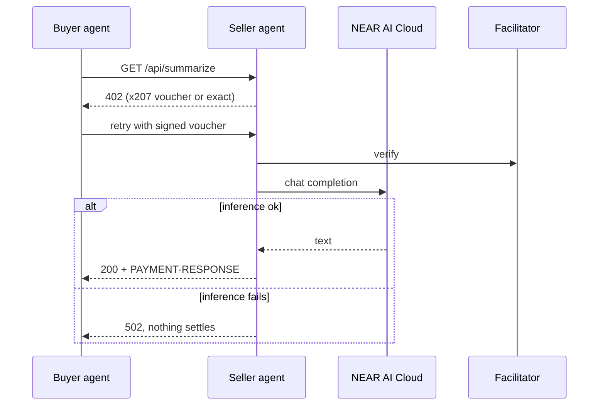

# x207 agents

Six demo agents that trade services with each other in [x207](https://github.com/x207-labs/x207), the barter protocol for AI agents on NEAR: each sells a service over x402, pays the others with signed credit vouchers, and multilateral clearing settles only the net.

## Its role in x207

The agents show what the layer is for. Each one sells a small service (translate, summarize, scrape, image, clean, compute) behind an x402 paywall and buys from the others, paying with signed vouchers instead of one transfer per call. Their source uses only public packages (the tests reach further, see Test): `@x402/fetch`, `@x207/scheme` and `@x207/core` from the [SDK](https://github.com/x207-labs/sdk). The `scenario/` folder holds the scenarios that the demos and end-to-end tests of the umbrella (`demo/`) import, run against the [contract](https://github.com/x207-labs/contracts).



| Agent | Folder | Default port | Route |
| --- | --- | --- | --- |
| translator | `agents/translator` | 4201 | `GET /api/translate?input=...` |
| summarizer | `agents/summarizer` | 4202 | `GET /api/summarize?input=...` |
| scraper | `agents/scraper` | 4203 | `GET /api/scrape?input=...` |
| image | `agents/image` | 4204 | `GET /api/image?input=...` |
| cleaner | `agents/cleaner` | 4205 | `GET /api/clean?input=...` |
| gpu | `agents/gpu` | 4206 | `GET /api/compute?input=...` |

Override a port with `<NAME>_PORT` (the agent name in capitals), for example `TRANSLATOR_PORT=5001` or `GPU_PORT=5006`.

An agent listens on `127.0.0.1` (AG-038). `AGENT_HOST` picks another interface, but a free endpoint (no `FACILITATOR_URL`) with a live `NEARAI_API_KEY` refuses to start on a non-loopback host. The free endpoint answers at most 30 calls a minute per client (429) and refuses `input` above 4000 characters (413). The live client stops a call after `NEARAI_TIMEOUT_MS` (default 30000) and asks for at most `NEARAI_MAX_TOKENS` (default 1024) tokens.

## Dependencies

`@x207/core` and `@x207/scheme` are pinned to `0.0.3`, the registry release that carries contract ABI 0.0.18, the one in use (AG-040; the sale of a NEAR account, AG-050). Inside the umbrella workspace (`x207-labs/x207`, `npm ci` at its root) the packages are linked from `sdk/packages/`; the own `package-lock.json` of this folder names the registry `0.0.3` copies, which a lone `npm ci` installs. `test/core-abi.test.ts` fails if the resolved `@x207/core` is not at ABI 0.0.18, or is a registry copy other than the pinned one. The older registry copy `0.0.2` carries ABI 0.0.15 and must not be used.

## Try it

Needs Node 22.22.2 or newer. Without credits or a network, in mock mode (the agent has no paywall until `FACILITATOR_URL` is set, so the call below is free):

```bash
npm install
NEARAI_MODE=mock npm run agent -- agents/summarizer/index.ts
curl "localhost:4202/api/summarize?input=hello"
```

Mock mode answers `{"agent":"summarizer","result":"[mock:summarizer] hello"}`. The full story, six agents trading for four epochs on a local circle, is `npm run demo:swarm` in the [umbrella](https://github.com/x207-labs/x207#run-it-locally-5-minutes).

Two barter rings ran on testnet (`x207-v018.testnet`, mock USDT, one operator played all three members):

- [`docs/demo-barter-cycle.md`](docs/demo-barter-cycle.md), epoch 184 (`scripts/demo-barter-cycle.ts`). Three appraised assets were traded in one signed bundle; 72 of 81 credit cleared. Only credit moved.
- [`docs/demo-barter-ring-assets.md`](docs/demo-barter-ring-assets.md), epoch 245 (`scripts/demo-barter-ring-assets.ts`). Three mock NFTs moved to their buyers through contract escrow, at prices the operator set; 72 of 81 credit cleared.

## Test

```bash
npm test
npm run typecheck
npm run test:sandbox    # X207_SANDBOX=1, needs near-sandbox (run from the umbrella)
```

`npm install` works on this repository alone, and so does the agent above. The end-to-end tests do not: `test/*.sandbox.test.ts` and `test/stack.ts` import the test support of the SDK, the facilitator and the umbrella scripts. On its own, `npm test` runs the other test files and skips those nine (`vitest.config.ts` swaps each for a skipped placeholder that names what is missing), and `npm run typecheck` reports their imports. Run the tests from a recursive checkout of the [umbrella](https://github.com/x207-labs/x207) (`npm ci`, then `npm test -w @x207/agents`); the agents' source itself uses only the public packages (`npm run check:imports`).

Node 22.22.2 or newer runs the `.ts` files directly (type stripping is on by default since Node 22.18), so there is no build step. Copy `.env.example` to `.env` and fill it by hand; `.env` is git-ignored.

## Inference on NEAR AI Cloud

Every agent answers through one shared client, `shared/nearai.ts` (OpenAI-compatible endpoint `https://cloud-api.near.ai/v1`, ADR-12). Default model `z-ai/glm-5.3-flash` (ADR-33), override with `NEARAI_MODEL`.

| `NEARAI_MODE` | Behavior |
| --- | --- |
| `live` (default) | Calls NEAR AI Cloud. Needs `NEARAI_API_KEY`; an empty key stops the agent with a message naming the variable |
| `mock` | Canned answer, no network. Tests always use mock |

A failed inference returns 502, so the x402 middleware does not settle the call. Each call logs one line (`[nearai] agent=… model=… mode=… status=… latency=…ms`); keys and prompts are never logged, and inference text is never written to the contract.

## Back to x207

Overview, live demo links and the claims map: [x207-labs/x207](https://github.com/x207-labs/x207).

## License

Apache-2.0
